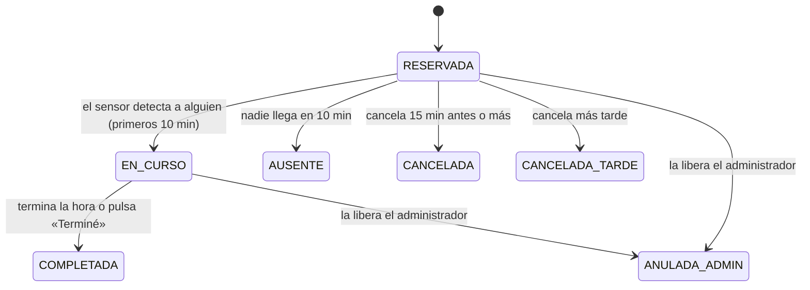

# Reservas de cubículos – Tecsup

Página para reservar los 4 cubículos de Tecsup, sincronizada con la maqueta (ESP32 + sensor PIR + tira LED + DFPlayer).
Proyecto de Investigación e Innovación Tecnológica. El estudiante ve en vivo qué cubículos están libres u ocupados y reserva
su hora; el administrador los monitorea y los libera u ocupa a mano; el sensor de cada cubículo confirma si llegó gente.

## Reglas

- 4 cubículos, atención de 07:00 a 19:00 (hora de Lima), de lunes a viernes. Todo se cambia en `backend/src/main/resources/application.yml`.
- Solo se reserva para el mismo día, en turnos de 1 hora en punto. **1 hora al día por estudiante.**
- **Relevos:** N personas suman sus horas y apartan N horas seguidas en el mismo cubículo (todo o nada). Cada una gasta su hora.
- **Llegada:** el sensor debe detectar a alguien en los primeros **10 minutos** del turno. Si no, la sala se libera sola y la luz se apaga.
  Con la llegada confirmada, el cubículo sigue ocupado hasta que termine la hora (el PIR no ve a quien está quieto). Salir antes: botón «Terminé».
- Cancelar hasta 15 min antes devuelve la hora; cancelar más tarde la gasta (no cuenta como ausencia). No llegar cuenta como ausencia;
  con 2 ausencias seguidas, las reservas quedan en pausa 1 día de atención. En un relevo, la ausencia se anota solo a quien reservó.
- El administrador libera, ocupa o pone en mantenimiento un cubículo **con motivo**, y queda en el registro (quién, cuándo, por qué).
  Ve los códigos completos; los estudiantes nunca ven los de otros.



| Estado del cubículo | Color en la página | Luz de la maqueta | Sonido de la maqueta |
|---|---|---|---|
| Libre | verde | apagada | — |
| Reservado, aún no llega | ámbar | ámbar | — |
| Ocupado (llegaron) | azul | azul | bienvenida (individual o de grupo) |
| Quedan 5 min | rojo | roja | aviso |
| Mantenimiento | violeta | violeta | — |
| Termina la hora | verde | se apaga | despedida |

## Estructura

```
Reservas-Cubiculos/
├── README.md · .gitignore
├── sql/crear-bd.sql                  (solo producción)
├── postman/                          (colección para probar la API)
├── backend/                          Spring Boot 3.5 · Java 21 · Maven
│   └── src/main/java/com/tecsup/reservas/
│       ├── model/        entidades (Usuario, Cubiculo, Reserva, RegistroAdmin) y enums
│       ├── dto/          entradas y salidas de la API
│       ├── repository/   acceso a datos (Spring Data JPA)
│       ├── services/     reglas del negocio (interfaz + impl/)
│       ├── controller/   solo HTTP: estudiante, admin, maqueta y simulador
│       ├── exception/    errores con formato {codigo, mensaje}
│       ├── security/     JWT y token de la maqueta
│       └── config/       propiedades, reloj, seguridad y datos de demostración
└── frontend/                         React 19 · Vite 7 · Vitest
    └── src/ components/ · pages/estudiante · pages/admin · hooks/ · services/ · routes/ · styles/
```

## Cómo correrlo (desarrollo)

Necesitas Java 21 y Node 24. No hace falta instalar ninguna base de datos (en desarrollo usa H2 en memoria).
Puertos: API **8095** y web **5195** (a propósito distintos de los de otros proyectos).

```bash
cd backend
./mvnw spring-boot:run -Dspring-boot.run.profiles=dev     # en Windows: .\mvnw.cmd ... "-Dspring-boot.run.profiles=dev"
```

```bash
cd frontend
npm install
npm run dev                                               # abre http://localhost:5195
```

- La pantalla de ingreso trae botones de **modo demostración** (estudiantes DEMO01 a DEMO12 y el administrador), que solo existen en el perfil `dev`.
  La clave de prueba del administrador y el token del sensor de desarrollo están en `application-dev.yml`: **son solo para desarrollo**.
- En `dev` el reloj es simulado: arranca hoy a las 10:00 y la atención abre todos los días. En **Administrador → Simulador** se adelanta el reloj
  y se simula el sensor de cada cubículo (con una guía de prueba paso a paso). «Restablecer demo» vuelve todo al inicio.
- Documentación de la API: http://localhost:8095/swagger-ui.html (el JSON, para importar en Postman, en `/v3/api-docs`).

## Pruebas

```bash
cd backend  && ./mvnw test        # 31 pruebas: reglas, relevos, los 10 minutos, concurrencia y seguridad
cd frontend && npm test           # 20 pruebas de componentes y formatos
```

## Conectar la maqueta (para quien haga el firmware)

La página ya tiene todo el lado del servidor; falta programar el ESP32. La maqueta usa HTTP y la cabecera `X-Sensor-Token`
(variable `RESERVAS_SENSOR_TOKEN` en producción). `{n}` es el número del cubículo (1 a 4):

| Llamada | Cuándo |
|---|---|
| `POST /api/sensores/{n}/presencia` | el PIR detectó a alguien |
| `POST /api/sensores/{n}/latido` | señal de vida (cada ~5 s) |
| `GET /api/sensores/{n}/estado` | para saber qué luz mostrar (cada ~3 s; también cuenta como latido) |

Respuesta de las tres: `{ cubiculo, estado, luz, tipoReserva, minutosRestantes, checkInConfirmado, ahora }`.
`luz` es `APAGADA | AMBAR | AZUL | ROJO | VIOLETA`. La respuesta a `presencia` trae `checkInConfirmado: true` solo cuando esa detección
confirmó la llegada: ahí se reproduce la bienvenida. El resto de sonidos se deducen de los cambios de estado
(pasa a ROJO → aviso; deja de estar ocupado → despedida; `tipoReserva` indica si es individual o de grupo).

```bash
curl -X POST http://localhost:8095/api/sensores/1/presencia -H "X-Sensor-Token: <token>"
```

Consejos para el firmware: esperar el calentamiento del PIR (30 a 60 s) antes de reportar presencia; si no hay WiFi, seguir
como el sketch actual (PIR → luz azul), y no subir nada a la placa sin confirmar qué sketch es. La clave del WiFi va en un archivo local
(`secrets.h`) que no se sube a git.

## Producción

Perfil `prod`: PostgreSQL y secretos por variables de entorno (`application-prod.yml`):
`RESERVAS_DB_URL`, `RESERVAS_DB_USUARIO`, `RESERVAS_DB_CLAVE`, `RESERVAS_JWT_SECRETO` (mínimo 32 caracteres), `RESERVAS_SENSOR_TOKEN`, `RESERVAS_CORS`.
Crear la base con `sql/crear-bd.sql`; las tablas las crea la aplicación. En `prod` no existen las cuentas de demostración ni el simulador.

## Para reforzar después

- **Identificación:** hoy el estudiante entra solo con su código o correo (validado contra la tabla `usuarios`); cualquiera podría escribir el código de otra persona
  y, en un relevo, gastarle la hora. La seguridad usa JWT con las clases de Spring Security: para el login institucional basta cambiar el `JwtDecoder` por el del proveedor.
- **Sensor sin señal:** si el sensor no da señal cuando vencen los 10 minutos, la sala se libera igual. Decidir qué hacer.
- Respaldo del check-in (botón «Ya llegué» o un QR en el cubículo), aviso al estudiante antes de su turno y audios por categoría.
- Cargar la lista real de estudiantes (hoy son cuentas de demostración).
